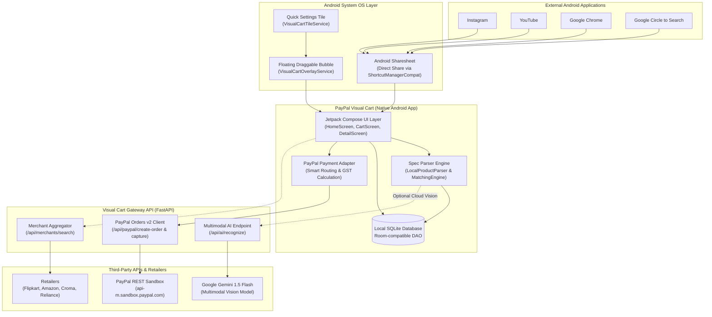
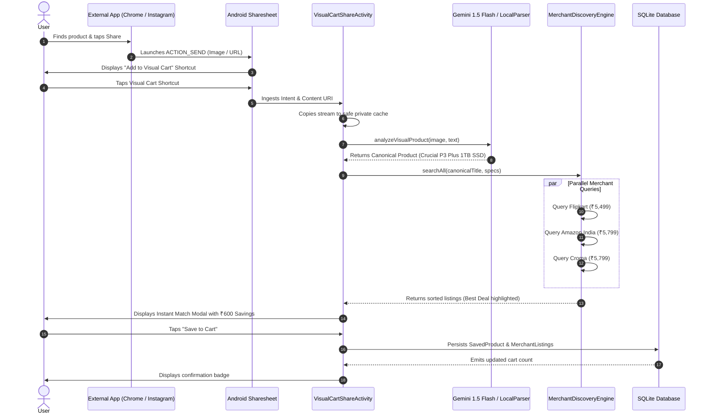
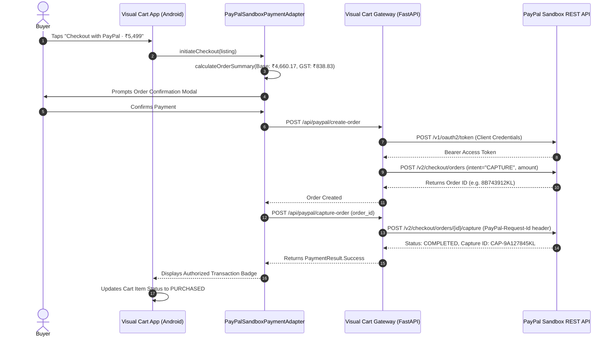
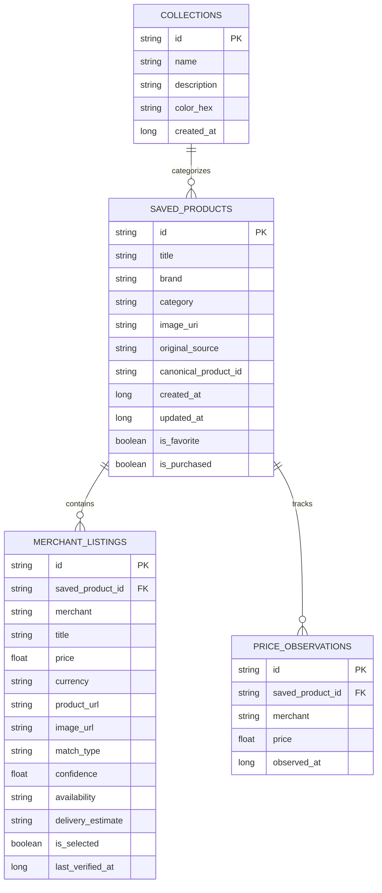

# PayPal Visual Cart - System Design & Technical Architecture

> **Document Version**: 1.0.0  
> **Date**: November 2026  
> **Project**: PayPal Visual Cart  
> **Visual Palette**: Warm Ivory (`#F6F3EC`), Deep Ink (`#202B32`), Forest Green (`#356B57`), Muted Sage (`#A6B5A0`), Terracotta (`#C97858`)

---

## 1. High-Level System Architecture

PayPal Visual Cart is designed as a distributed, privacy-first mobile commerce architecture. It pairs an Android native client with a lightweight FastAPI gateway connecting to **Google Gemini Multimodal AI** and the **PayPal Orders v2 REST API**:



---

## 2. Android Client Layered Architecture (Clean Architecture & MVVM)

The Android application strictly adheres to Clean Architecture separation of concerns:

```
+─────────────────────────────────────────────────────────────────────────────+
|                            PRESENTATION LAYER                               |
|                                                                             |
|  - Jetpack Compose Screens: HomeScreen, CartScreen, ProductDetailScreen     |
|  - System Ingestion UI: VisualCartShareActivity, ShareCaptureScreen         |
|  - Floating Overlay Modal: overlay_capture_popup.xml                        |
|  - Design System Components: VisualCartButton, ConfidenceIndicator,         |
|    MerchantLogoBadge, SpecTag, PriceHistoryGraph                            |
+──────────────────────────────────────┬──────────────────────────────────────+
                                       │
                                       ▼
+─────────────────────────────────────────────────────────────────────────────+
|                              DOMAIN LAYER                                   |
|                                                                             |
|  - Core Models: RecognizedProduct, MerchantListing, MatchResult,            |
|    OrderSummary, ParsedProductMetadata                                      |
|  - Repository Interfaces: CartRepository                                    |
|  - Business Use Cases: Match & Compare, Price Aggregation, GST Calculation  |
+──────────────────────────────────────┬──────────────────────────────────────+
                                       │
                                       ▼
+─────────────────────────────────────────────────────────────────────────────+
|                            FEATURE ENGINES                                  |
|                                                                             |
|  - AI & Vision: CloudProductUnderstandingProvider, LocalProductParser,       |
|    ProductMatchingEngine, NaturalLanguageCartFilter                         |
|  - Merchant Adapters: AmazonIndiaAdapter, FlipkartAdapter, CromaAdapter,    |
|    RelianceDigitalAdapter, MyntraAdapter, TataCliqAdapter                   |
|  - Payment Engine: PayPalSandboxPaymentAdapter, PaymentProvider             |
+──────────────────────────────────────┬──────────────────────────────────────+
                                       │
                                       ▼
+─────────────────────────────────────────────────────────────────────────────+
|                         DATA & LOCAL STORAGE LAYER                          |
|                                                                             |
|  - Relational SQLite Engine: VisualCartDatabase                             |
|  - Data Access Object: CartDao                                              |
|  - Entities: SavedProductEntity, MerchantListingEntity, CollectionEntity,   |
|    PriceObservationEntity                                                   |
|  - Reactive Streams: Kotlin Flow & StateFlow                                |
+─────────────────────────────────────────────────────────────────────────────+
```

---

## 3. Sequence Diagrams

### 3.1 Visual Capture & Multi-Merchant Discovery Flow



---

### 3.2 PayPal Orders v2 Checkout Sequence



---

## 4. Relational Data Model & Entity-Relationship Diagram (ERD)

The persistent storage architecture implements Room-compatible relational tables with foreign key cascades:



---

## 5. Security, Privacy & Network Boundaries

### 5.1 Content URI Security & Sandboxed Image Decoding
- Incoming image streams received via `ACTION_SEND` have transient read permissions granted by Android OS.
- `SafeImageDecoder.copyUriToPrivateCache` immediately creates an isolated copy within the app's sandboxed `cacheDir/shared_captures/`.
- Mitigates runtime `SecurityException` when originating apps terminate.
- Capped memory downsampling guarantees zero `OutOfMemoryError` conditions.

### 5.2 Strict URL Allowlisting & XSS Sanitization
- `SecurityUtils.sanitizeWebUrl` enforces an explicit protocol allowlist: only `https://` and `http://` are permitted.
- Custom URI schemes, JavaScript execution attempts (`javascript:`), and malformed intents are strictly rejected.
- Query tracking parameters (UTM parameters, referral tags) are sanitized before opening external merchant Custom Tabs.

### 5.3 Credential Isolation & Zero Hardcoded Secrets
- No client secret or API key is ever embedded into compiled APK binaries.
- The Android client communicates with the backend gateway, which maintains PayPal OAuth client credentials and Gemini AI tokens securely server-side.

### 5.4 Android 14/15 Foreground Service Policy
- `VisualCartOverlayService` is registered as `foregroundServiceType="specialUse"` with the required manifest declaration `android.app.PROPERTY_SPECIAL_USE_FGS_SUBTYPE`.
- An ongoing low-priority notification is maintained, providing users with instant 1-tap dismissal for full transparency.

---
*End of System Design & Technical Architecture.*
