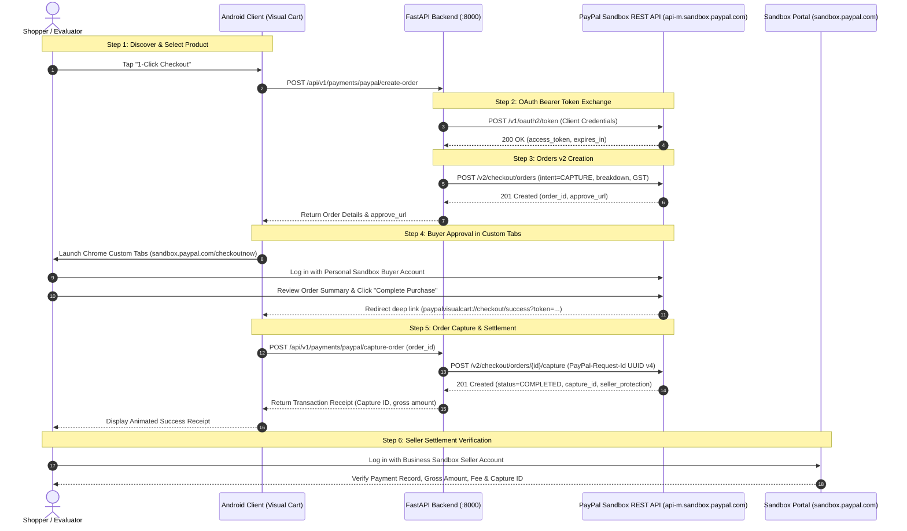

# PayPal Developer Sandbox - Complete End-to-End Runbook

> **Guide Version**: 1.0.0  
> **Target Environment**: PayPal Developer Sandbox & Visual Cart Android Client  
> **Reference Standard**: [paypaldev/getting-started-with-paypal-sandbox](https://github.com/paypaldev/getting-started-with-paypal-sandbox)  
> **Author**: Integration & QA Engineering Team  
> **Architecture Pattern**: Decoupled Client-Server with Zero Hardcoded Secrets

---

## 1. Overview & Architecture Blueprint

This runbook provides developers, QA engineers, and hackathon evaluators with the step-by-step developer guide to configure, launch, test, and verify **PayPal Visual Cart** against official PayPal Sandbox infrastructure.

### Transaction Lifecycle Flow



---

## 2. Prerequisites Checklist

Before beginning, ensure you have:
- [x] A primary PayPal account to access [developer.paypal.com](https://developer.paypal.com).
- [x] Python 3.10+ installed with `pip`.
- [x] Android Studio (Ladybug / Iguana or later) with Android SDK 34/35.
- [x] An Android device (physical with USB debugging OR Android Virtual Device emulator).
- [x] Android SDK platform-tools (`adb`) on your system PATH.

---

## 3. Developer Portal Setup (Step-by-Step)

Following official guidelines from [paypaldev/getting-started-with-paypal-sandbox](https://github.com/paypaldev/getting-started-with-paypal-sandbox):

### Step 3.1: Log in to PayPal Developer Dashboard
1. Open your web browser and navigate to:  
   👉 **[https://developer.paypal.com](https://developer.paypal.com)**
2. Click **Log In to Dashboard** in the top-right corner.
3. Sign in using your live personal or business PayPal credentials. (This grants access to developer tools; no real charges occur).

---

### Step 3.2: Inspect & Configure Sandbox Accounts
1. In the left navigation sidebar, navigate to:  
   **Testing Tools** &rarr; **Sandbox Accounts**  
   *(Direct URL: `https://developer.paypal.com/dashboard/accounts`)*
2. By default, PayPal automatically provisions two sandbox accounts:
   - **Business (Merchant)**: e.g., `sb-biz4321@business.example.com`
   - **Personal (Buyer)**: e.g., `sb-buyer1234@personal.example.com`
3. Click the three dots (**...**) icon on the right side of the **Personal Account** and select **View/Edit Account**:
   - Note the **Email ID** (e.g., `sb-xxxx-buyer@personal.example.com`).
   - Note the **System-Generated Password** (or set a custom password for easy login).
   - Inspect the **Funding tab**: Confirm fake sandbox balance (e.g., $5,000.00 USD) and test credit card numbers.
4. Click the three dots (**...**) on the **Business Account** and select **View/Edit Account**:
   - Note the **Email ID** (e.g., `sb-xxxx-biz@business.example.com`).
   - Note the **System-Generated Password**.
   - This account will receive funds and let you audit transactions in Sandbox PayPal.

> [!TIP]
> If you need INR test transactions, create a custom Business sandbox account with **Country: India** and select INR as primary currency. Otherwise, Visual Cart automatically uses standard USD settlement, which works out of the box with default US sandbox accounts.

---

### Step 3.3: Obtain Sandbox App Credentials
1. In the left sidebar, click **Apps & Credentials**  
   *(Direct URL: `https://developer.paypal.com/dashboard/applications/sandbox`)*
2. Ensure the top toggle is set to **Sandbox** (not Live).
3. Under the **REST API apps** section, you will see `Default Application` (or click **Create App** and name it `PayPal Visual Cart`).
4. Click the app name to view credentials:
   - **Client ID**: Copy the 80-character string (e.g., `Aabc123...`).
   - **Secret**: Click **Show** and copy the secret key.

---

## 4. Environment Configuration (`.env`)

Never commit credentials to version control. Set up the local `.env` file in the project root:

```bash
# In the root of antigravity/ez:
cp .env.example .env
```

Edit `.env` and fill in your sandbox credentials:

```dotenv
# ==============================================================================
# PayPal Visual Cart - Sandbox Environment Configuration
# ==============================================================================

# 1. PayPal Developer Credentials (Sandbox)
PAYPAL_CLIENT_ID=your_paypal_sandbox_client_id_here
PAYPAL_CLIENT_SECRET=your_paypal_sandbox_client_secret_here

# PayPal Environment: 'sandbox'
PAYPAL_MODE=sandbox
PAYPAL_ENV=sandbox

# PayPal Base REST API URL
PAYPAL_BASE_URL=https://api-m.sandbox.paypal.com

# Currency settings
PAYPAL_CURRENCY=USD
INR_TO_USD_RATE=0.012

# 2. Google Gemini Multimodal Vision API (Optional - local heuristics used if empty)
GEMINI_API_KEY=your_gemini_api_key_here
GEMINI_MODEL=gemini-2.5-flash

# 3. Visual Cart FastAPI Backend Server
BACKEND_HOST=0.0.0.0
BACKEND_PORT=8000
CORS_ORIGINS=*
```

---

## 5. Starting the FastAPI Backend Service

### Step 5.1: Install Dependencies
```bash
# Ensure pip is up to date
pip install -r server/requirements.txt
# (or for backend gateway): pip install -r backend/requirements.txt
```

### Step 5.2: Launch the Server
```powershell
# Run the FastAPI server on 0.0.0.0:8000
python -m uvicorn server.main:app --host 0.0.0.0 --port 8000 --reload
```

### Step 5.3: Verify Readiness & Configuration
Run health and config curls from another terminal:

```bash
# 1. Health check
curl -X GET http://localhost:8000/health
# Expected: {"status":"healthy","has_paypal_credentials":true,"mode":"sandbox"}

# 2. Public configuration check (never leaks secret)
curl -X GET http://localhost:8000/api/v1/payments/paypal/configuration
# Expected:
# {
#   "client_id": "Aabc123...",
#   "mode": "sandbox",
#   "default_currency": "USD",
#   "brand_name": "PayPal Visual Cart Demo Store",
#   "is_sandbox": true,
#   "is_live_configured": true,
#   "deep_link_scheme": "paypalvisualcart"
# }
```

---

## 6. Device Network Bridge (ADB Reverse)

The mobile client needs to communicate with your local FastAPI server at port 8000.

### Scenario A: Physical Android Device via USB
When running on a physical phone connected over USB debugging:
```bash
# Verify device is recognized
adb devices

# Reverse port 8000 so phone requests to localhost:8000 reach computer
adb reverse tcp:8000 tcp:8000
```
*Visual Cart automatically detects `http://localhost:8000` via ADB reverse on physical devices.*

### Scenario B: Android Virtual Device (Emulator)
When running on the official Android Studio emulator:
- Android emulators route host machine localhost through IP **`10.0.2.2`**.
- `PayPalBackendClient.kt` automatically checks `http://10.0.2.2:8000` first.
- No `adb reverse` command is strictly necessary, though running `adb reverse tcp:8000 tcp:8000` works seamlessly for both!

---

## 7. Running the Checkout Flow on Android Device

### Step 7.1: Build and Launch the Application
```powershell
# Build and install debug APK
.\gradlew.bat installDebug

# Or run via Android Studio 'Run' button
```

### Step 7.2: Initiate Checkout
1. Open **Visual Cart**.
2. Select any product from the cart (e.g., **Crucial P3 Plus 1TB SSD** or **Samsung 990 EVO**).
3. The app displays the server-authoritative itemized financial breakdown:
   - **Subtotal**: ₹4,660.17 ($54.99)
   - **GST @ 18%**: ₹838.83 ($9.89)
   - **Delivery**: FREE ($0.00)
   - **Total Authorized**: ₹5,499.00 ($64.88)
4. Tap **PayPal 1-Click Checkout**.

---

## 8. Buyer Login & Approval Flow

1. The Android app launches **Chrome Custom Tabs** pointing to:  
   `https://www.sandbox.paypal.com/checkoutnow?token=ORDER_ID`
2. **Log in**: Enter the **Personal Buyer Sandbox Account** email and password from [Step 3.2](#step-32-inspect--configure-sandbox-accounts):
   - Email: `sb-xxxx-buyer@personal.example.com`
   - Password: `<your_sandbox_buyer_password>`
3. **Select Payment Method**: Choose your fake PayPal Balance or Sandbox Visa card.
4. Tap **Complete Purchase** (or **Pay Now**).
5. PayPal redirects to the registered deep link:  
   `paypalvisualcart://checkout/success?token=ORDER_ID&PayerID=PAYER_ID`
6. `PayPalDeepLinkActivity` intercepts the intent, invokes `POST /api/v1/payments/paypal/capture-order` with a unique UUID v4 idempotency key.
7. Visual Cart transitions to the **Order Confirmed** screen displaying:
   - Authentic PayPal Capture ID (e.g. `CAP-9A127845KL`)
   - Completed Timestamp
   - PayPal Buyer Protection Badge
   - Payer Email confirmation

---

## 9. Business Seller Settlement Verification

To verify that fake money actually moved from the buyer to your merchant account:

1. Open a clean browser window (Incognito mode recommended to avoid session collisions).
2. Go to **[https://www.sandbox.paypal.com](https://www.sandbox.paypal.com)**.
3. Sign in using your **Business Sandbox Account** credentials:
   - Email: `sb-xxxx-biz@business.example.com`
   - Password: `<your_sandbox_biz_password>`
4. In the main menu, navigate to **Activity** &rarr; **All Transactions**.
5. Locate the newest transaction at the top of the activity feed:
   - **Gross Amount**: Matches the order total (e.g., `+$64.88 USD`).
   - **Fee**: PayPal sandbox processing fee deducted (e.g., `-$2.18 USD`).
   - **Net Amount**: Credited to your sandbox merchant balance (e.g., `+$62.70 USD`).
6. Click the transaction row to inspect transaction details:
   - Verify the **Transaction ID / Capture ID** matches the ID shown on the mobile app screen.
   - Verify **Seller Protection**: *Eligible*.

---

## 10. Negative Testing & Resiliency Checklist

PayPal Sandbox provides mock response capabilities to test edge cases without needing real payment failures.

### 10.1 Testing `INSTRUMENT_DECLINED`
Simulates a buyer using an expired card, insufficient funds, or a declined credit instrument.

1. Issue capture request with the `PayPal-Mock-Response` header:
   ```bash
   curl -X POST http://localhost:8000/api/v1/payments/paypal/capture-order \
     -H "Content-Type: application/json" \
     -H "PayPal-Mock-Response: {\"mock_application_codes\":\"INSTRUMENT_DECLINED\"}" \
     -d '{"order_id": "YOUR_ORDER_ID"}'
   ```
2. **Expected Server Response**: `HTTP 422 Unprocessable Entity`
   ```json
   {
     "detail": "PayPal error [INSTRUMENT_DECLINED] (debug_id: sbx_dbg_...): The instrument presented was declined. Try a different payment method."
   }
   ```
3. **App Behavior**:
   - The app intercepts HTTP 422 / INSTRUMENT_DECLINED.
   - Displays user-friendly modal: *"Your payment instrument was declined by your bank or card issuer. Please select a different payment method on PayPal."*
   - Cart contents remain safe; user can re-attempt approval immediately.

---

### 10.2 Testing `DUPLICATE_INVOICE_ID`
Simulates a retry attempt with an invoice number that was previously settled.

1. Issue request with `DUPLICATE_INVOICE_ID`:
   ```bash
   curl -X POST http://localhost:8000/api/v1/payments/paypal/capture-order \
     -H "Content-Type: application/json" \
     -H "PayPal-Mock-Response: {\"mock_application_codes\":\"DUPLICATE_INVOICE_ID\"}" \
     -d '{"order_id": "YOUR_ORDER_ID"}'
   ```
2. **Expected Server Response**: `HTTP 422 Unprocessable Entity`
   ```json
   {
     "detail": "PayPal error [DUPLICATE_INVOICE_ID] (debug_id: sbx_dbg_...): The invoice ID has been used on a previous payment."
   }
   ```
3. **App Behavior**: Displays error notification and prompts user to generate a fresh checkout session.

---

### 10.3 Testing Idempotency & Network Drop Resilience
Simulates mobile 5G connection drop during checkout settlement:

1. Send capture with client idempotency key:
   ```bash
   curl -X POST http://localhost:8000/api/v1/payments/paypal/capture-order \
     -H "Content-Type: application/json" \
     -d '{"order_id": "ORDER_123", "idempotency_key": "idemp-uuid-4444"}'
   ```
2. Repeat the identical call immediately:
   ```bash
   curl -X POST http://localhost:8000/api/v1/payments/paypal/capture-order \
     -H "Content-Type: application/json" \
     -d '{"order_id": "ORDER_123", "idempotency_key": "idemp-uuid-4444"}'
   ```
3. **Verification**:
   - Both calls return `200 OK` with identical `capture_id`.
   - The second call is served from the idempotency cache without re-charging the buyer or issuing duplicate fund transfers.

---

### 10.4 Production Safety Lock
- The backend strictly forbids `PayPal-Mock-Response` headers when `PAYPAL_MODE != "sandbox"`.
- Requests attempting mock injections in live production return `HTTP 400 Bad Request` with an immediate security audit warning.

---

## 11. Troubleshooting Guide

| Issue | Root Cause | Solution |
| :--- | :--- | :--- |
| **`Connection refused` on device** | Phone cannot reach PC port 8000 | Run `adb reverse tcp:8000 tcp:8000`. If on Wi-Fi, ensure firewall allows inbound port 8000. |
| **`Failed to authenticate with PayPal: invalid_client`** | Wrong Sandbox Client ID or Secret | Verify `PAYPAL_CLIENT_ID` and `PAYPAL_CLIENT_SECRET` in `.env` against Developer Dashboard Sandbox tab. |
| **`CURRENCY_NOT_ALLOWED`** | INR not enabled on standard US sandbox account | The backend defaults `PAYPAL_CURRENCY=USD`. Or create an Indian Sandbox Business Account at `developer.paypal.com`. |
| **Custom Tabs blank or redirects to error** | Order ID expired or invalid return URL | Ensure backend returned a valid `approve_url` starting with `https://www.sandbox.paypal.com`. |
| **Deep link doesn't open app after approval** | Scheme not registered | Verify AndroidManifest contains `<data android:scheme="paypalvisualcart" android:host="checkout" />`. |

---

## 12. Quick Reference Commands

```bash
# Run all backend unit & security tests (45 tests)
pytest

# Run Android unit tests (32 tests)
.\gradlew.bat testDebugUnitTest

# Build debug APK
.\gradlew.bat assembleDebug

# Port forward phone to server
adb reverse tcp:8000 tcp:8000

# Start server
python -m uvicorn server.main:app --host 0.0.0.0 --port 8000 --reload
```
