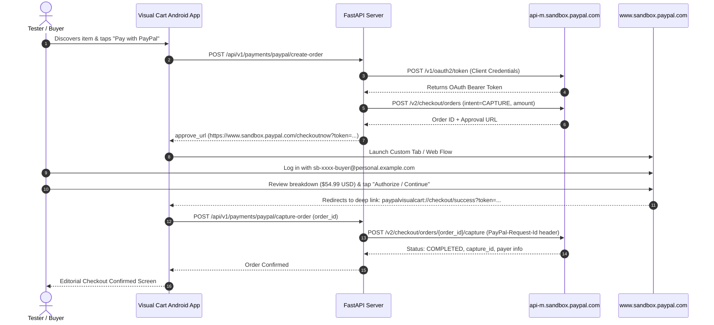

# PayPal Developer Sandbox Setup & Verification Guide

> **Document Version**: 1.0.0  
> **Target Environment**: PayPal Sandbox & Local Fast-Feedback Development  
> **Reference Implementation**: `paypaldev/getting-started-with-paypal-sandbox`  
> **Application**: PayPal Visual Cart (Android Kotlin Client + FastAPI Python Gateway)

---

## 1. Overview & Architecture

Visual Cart leverages PayPal's **Orders v2 REST API** to convert discovered products across any Android application into a single-tap, secure checkout experience.

To ensure zero production risk, rapid automated testing, and compliance with PayPal developer standards, all development and automated testing utilize the **PayPal Sandbox Environment**.

### The Three Sandbox Environments

PayPal isolates developer activities across three distinct environments and domain boundaries:

```
+─────────────────────────────────────────────────────────────────────────────────────────+
|                                PAYPAL SANDBOX ARCHITECTURE                              |
+─────────────────────────────────────────────────────────────────────────────────────────+
|                                                                                         |
|  1. DEVELOPER DASHBOARD               2. SANDBOX WEB PORTAL       3. SANDBOX REST API   |
|     https://developer.paypal.com         https://www.sandbox.       https://api-m.      |
|                                          paypal.com                 sandbox.paypal.com  |
|     ┌────────────────────────┐           ┌────────────────────┐     ┌─────────────────┐ |
|     │ • Create Sandbox Accts │           │ • Buyer Login      │     │ • /v1/oauth2/   │ |
|     │ • REST Apps & Secrets  │           │   (sb-buyer@...)   │     │   token (OAuth) │ |
|     │ • Webhook Simulators   │           │ • Seller Login     │     │ • /v2/checkout/ │ |
|     │ • Mock Email / Alerts  │           │   (sb-biz@...)     │     │   orders        │ |
|     │ • API Log Inspections  │           │ • Activity/Ledger  │     │ • /v2/checkout/ │ |
|     └───────────┬────────────┘           └─────────▲──────────┘     │   orders/capture│ |
|                 │ Configures                       │                └────────▲────────┘ |
|                 ▼                                  │ Approves                │ Executes |
|        [ Visual Cart Team ] ───────────────────────┴─────────────────────────┘          |
|                                                                                         |
+─────────────────────────────────────────────────────────────────────────────────────────+
```

| Environment Domain | Purpose | Intended User / Client | Primary Actions |
| :--- | :--- | :--- | :--- |
| **`developer.paypal.com`** | **Developer Dashboard** | Developers & Engineers | Create test buyer/business accounts, generate `Client ID` and `Client Secret`, monitor simulated emails/webhooks. |
| **`www.sandbox.paypal.com`** | **Sandbox Web Portal** | Simulated End-Users (Buyer & Merchant) | Log in as personal buyer to approve orders; log in as business merchant to inspect captured transactions and payouts. |
| **`api-m.sandbox.paypal.com`** | **Sandbox REST API Gateway** | Visual Cart Backend Service (`server/main.py` / `backend/main.py`) | Authenticate via OAuth 2.0 (`/v1/oauth2/token`), create orders (`/v2/checkout/orders`), capture settled funds. |

---

## 2. Step-by-Step Developer Portal Setup

Follow these exact steps to provision your PayPal Developer sandbox accounts and credentials.

### Step 2.1: Sign In to the PayPal Developer Portal
1. Open a browser and navigate to [https://developer.paypal.com](https://developer.paypal.com).
2. Click **Log In to Dashboard** in the upper right corner.
3. Authenticate with your real PayPal Developer account credentials.

---

### Step 2.2: Create Sandbox Test Accounts
A complete checkout lifecycle requires two isolated sandbox accounts:
- A **Business (Seller / Merchant)** account to receive funds and register the REST application.
- A **Personal (Buyer)** account to simulate the consumer authorizing payment in the sandbox portal.

#### A. Create the Business (Seller) Account
1. In the left navigation sidebar of the Developer Dashboard, navigate to **Testing Tools** > **Sandbox Accounts**.
2. Click **Create account**.
3. Select **Business (Merchant)** as the account type.
4. Select your primary testing Country/Region (e.g., **United States** for standard USD testing or **India** for domestic INR testing).
5. (Optional) Select **Custom Account** to set a specific email prefix and password:
   - Email format: `sb-xxxx-biz@business.example.com` (or accept the auto-generated email).
   - Password: Set a secure, memorable password for sandbox logins.
   - Account Balance: Set starting balance (default is `$5,000.00 USD`).
6. Click **Create account**.

#### B. Create the Personal (Buyer) Account
1. On the same **Sandbox Accounts** page, click **Create account** again.
2. Select **Personal (Buyer)** as the account type.
3. Select Country/Region (match the merchant country or choose **United States** for cross-border testing).
4. Specify account details:
   - Email format: `sb-xxxx-buyer@personal.example.com`.
   - Password: Set a test password.
   - Account Balance: Set starting balance (`$5,000.00 USD`).
   - PayPal automatically attaches a virtual credit card and simulated test bank account.
5. Click **Create account**.

> [!TIP]
> Keep a secure note of both test emails and passwords. You will use the buyer account to log into `www.sandbox.paypal.com` during manual checkouts, and the business account to review merchant payouts.

---

### Step 2.3: Create REST App & Obtain API Credentials
1. In the left sidebar, navigate to **Apps & Credentials**.
2. Locate the toggle switch at the top and ensure **Sandbox** mode is active (not Live).
3. Click **Create App**.
4. Configure the app parameters:
   - **App Name**: `PayPal Visual Cart Backend`
   - **App Type**: `Merchant`
   - **Sandbox Business Account**: Select the business account created in Step 2.2 (`sb-xxxx-biz@business.example.com`).
5. Click **Create App**.
6. The app detail page will display your credentials:
   - **Client ID**: A public alpha-numeric string (e.g., `AXXXXX...`). Safe for mobile clients and configuration checks.
   - **Secret**: Click **Show** to reveal the secret string. **NEVER share or commit this key to Git.**
7. In the **Return URL** section under **Features**, add the Visual Cart Android deep-link callbacks:
   - `paypalvisualcart://checkout/success`
   - `paypalvisualcart://checkout/cancel`

---

## 3. Environment Configuration & Secret Isolation

Visual Cart strictly adheres to the **Zero-Hardcoded Secrets Principle**. Sensitive credentials and access tokens reside solely in the server environment.

### Step 3.1: Initialize Local `.env` File
Copy the provided template to create your local environment file:

```bash
# From workspace root
copy .env.example .env
```

Populate the `.env` file with the sandbox credentials obtained in Step 2.3:

```ini
# ==============================================================================
# PayPal Developer Credentials (Sandbox)
# ==============================================================================
PAYPAL_CLIENT_ID=AXXXXXXXXXXXXX_YOUR_SANDBOX_CLIENT_ID
PAYPAL_CLIENT_SECRET=EXXXXXXXXXXXX_YOUR_SANDBOX_CLIENT_SECRET

# PayPal Environment: 'sandbox' (testing) or 'production' (live)
PAYPAL_MODE=sandbox
PAYPAL_ENV=sandbox

# Base API URL
PAYPAL_BASE_URL=https://api-m.sandbox.paypal.com

# Currency settings
PAYPAL_CURRENCY=USD
INR_TO_USD_RATE=0.012

# Optional Google Gemini Multimodal Vision API Key
GEMINI_API_KEY=your_gemini_api_key_here
GEMINI_MODEL=gemini-2.5-flash

# Backend Server Configuration
HOST=0.0.0.0
PORT=8000
CORS_ORIGINS=*
```

### Step 3.2: Verify Git Hygiene
Ensure that no environment secrets or local configuration files are tracked:

```bash
# Check git status - .env must never appear as tracked
git status

# Verify .gitignore rules
git check-ignore -v .env
git check-ignore -v server/.env
```

The Visual Cart `.gitignore` explicitly excludes:
- `.env`
- `*.env`
- `.env.*`
- `local.properties`
- `__pycache__/` and `*.pyc`

---

## 4. Backend Health & Readiness Checks

Visual Cart provides a dedicated status endpoint to verify PayPal sandbox readiness without exposing sensitive keys.

### GET `/api/v1/payments/paypal/configuration`

Query the endpoint to verify system status:

```bash
curl http://localhost:8000/api/v1/payments/paypal/configuration
```

#### Expected JSON Response (When Credentials are Configured)
```json
{
  "provider": "paypal",
  "mode": "sandbox",
  "credentials_configured": true,
  "oauth_ready": true,
  "orders_api_ready": true,
  "client_id": "AXXXXXXXXXXXXX_YOUR_SANDBOX_CLIENT_ID",
  "default_currency": "USD",
  "brand_name": "PayPal Visual Cart Demo Store",
  "is_sandbox": true,
  "is_live_configured": true,
  "deep_link_scheme": "paypalvisualcart"
}
```

#### Expected JSON Response (When Unconfigured / Fallback Simulation Mode)
```json
{
  "provider": "paypal",
  "mode": "sandbox",
  "credentials_configured": false,
  "oauth_ready": false,
  "orders_api_ready": false,
  "client_id": "sb-demo-client-id",
  "default_currency": "USD",
  "brand_name": "PayPal Visual Cart Demo Store",
  "is_sandbox": true,
  "is_live_configured": false,
  "deep_link_scheme": "paypalvisualcart"
}
```

> [!IMPORTANT]
> Notice that `PAYPAL_CLIENT_SECRET` and access tokens are strictly omitted from the API response payload, preventing secret leakage over public Wi-Fi or client inspection.

---

## 5. End-to-End Sandbox Checkout Walkthrough

Follow this full cycle to execute and verify an authentic sandbox purchase:



### Manual Approval in Browser
When testing outside the Android device or in terminal testing, you can approve orders directly in your web browser:
1. Copy the `approve_url` returned from `POST /api/v1/payments/paypal/create-order`.
2. Open an Incognito/Private window and navigate to that URL.
3. Log in with your **Personal Buyer Account** (`sb-xxxx-buyer@personal.example.com`).
4. Select your sandbox payment method (PayPal balance or mock card) and click **Complete Purchase** or **Continue**.
5. The browser will redirect to `paypalvisualcart://checkout/success?token=...&PayerID=...`.
6. Pass that `token` (Order ID) to the capture endpoint.

---

## 6. Verifying Sandbox Transaction History

After completing test captures, verify the settlement in PayPal's sandbox tools.

### 6.1: Merchant Ledger Verification
1. Navigate to [https://www.sandbox.paypal.com](https://www.sandbox.paypal.com).
2. Log in using your **Business Seller Account** (`sb-xxxx-biz@business.example.com`).
3. Navigate to **Activity** > **All Transactions**.
4. You will see the incoming transaction:
   - **Status**: Completed
   - **Gross Amount**: e.g., `+$54.99 USD`
   - **Fee**: e.g., `-$1.89 USD` (standard simulated processing fee)
   - **Net Amount**: e.g., `+$53.10 USD`
   - **Buyer Name & Email**: Corresponds to `sb-xxxx-buyer@personal.example.com`.

### 6.2: Buyer Account Statement Verification
1. In an Incognito window, navigate to [https://www.sandbox.paypal.com](https://www.sandbox.paypal.com).
2. Log in using your **Personal Buyer Account** (`sb-xxxx-buyer@personal.example.com`).
3. Check the **Recent Activity** ledger:
   - A debit of `$54.99 USD` paid to `PayPal Visual Cart Store`.
   - Remaining simulated balance updated accordingly.

### 6.3: Simulated Notifications & Emails
1. In the Developer Dashboard ([https://developer.paypal.com](https://developer.paypal.com)), go to **Testing Tools** > **Sandbox Notifications**.
2. You will observe simulated transactional emails triggered by PayPal:
   - **Payment Confirmation** sent to buyer.
   - **Merchant Notification: Payment Received** sent to seller.

---

## 7. Troubleshooting & Negative Testing

| Issue | Root Cause | Solution |
| :--- | :--- | :--- |
| **`401 Unauthorized: Invalid client credentials`** | `PAYPAL_CLIENT_ID` or `PAYPAL_CLIENT_SECRET` mismatch or contains placeholder values. | Verify credentials copied from Developer Dashboard under the **Sandbox** tab. Ensure no extra spaces or quotes. |
| **`422 Unprocessable Entity: ORDER_ALREADY_CAPTURED`** | Client attempted to capture an order that was already captured. | Visual Cart backend prevents duplicate captures using in-memory idempotency guards and the `PayPal-Request-Id` HTTP header. |
| **`Sandbox login loop / Invalid Password`** | Attempting to log into `www.sandbox.paypal.com` with real PayPal account, or password typo. | Use the credentials configured in **Testing Tools** > **Sandbox Accounts**. Reset test password if necessary. |
| **`Currency Not Supported`** | Personal buyer account country does not support requested currency. | Visual Cart includes automatic INR-to-USD conversion (`INR_TO_USD_RATE=0.012`) to support universal USD sandbox accounts. |
| **`Simulating Declined Cards`** | Need to test instrument declined or insufficient funds scenarios. | Pass negative testing headers in requests: `PayPal-Mock-Response: {"mock_application_codes": "INSTRUMENT_DECLINED"}`. |

---

## 8. Summary Checklist for CI/CD & Demonstrations

- [x] Dedicated Personal Buyer Sandbox Account created.
- [x] Dedicated Business Seller Sandbox Account created.
- [x] REST App created in Sandbox mode with Client ID & Secret generated.
- [x] Return URLs registered: `paypalvisualcart://checkout/success` & `cancel`.
- [x] `.env` populated locally and verified absent from `git status`.
- [x] `GET /api/v1/payments/paypal/configuration` reports `provider=paypal` and `mode=sandbox`.
- [x] End-to-end create and capture orders verified in `www.sandbox.paypal.com` ledger.
- [x] Fallback offline simulation validated when credentials are not configured.
